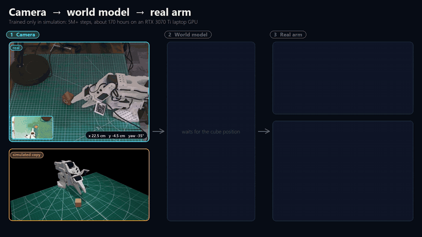
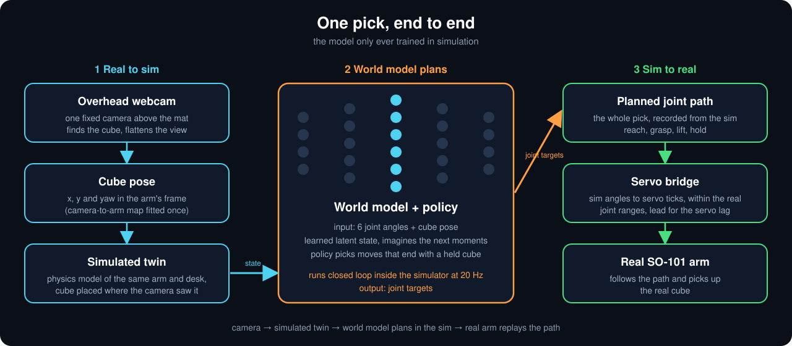
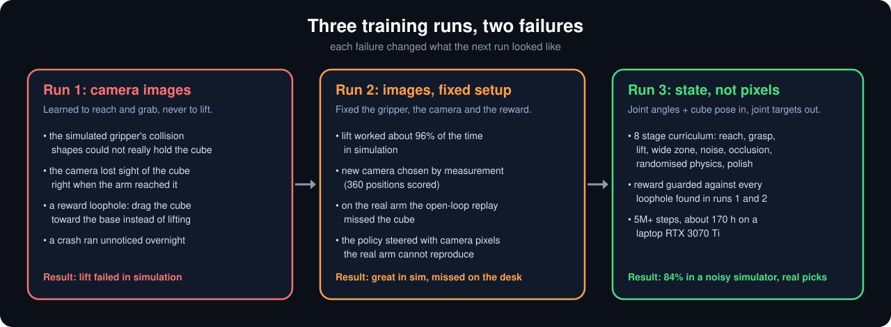
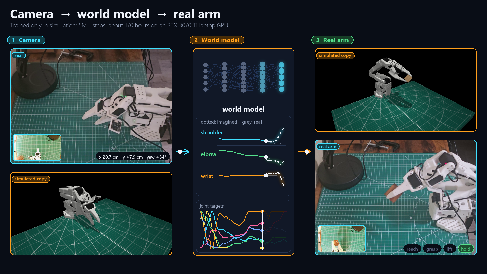
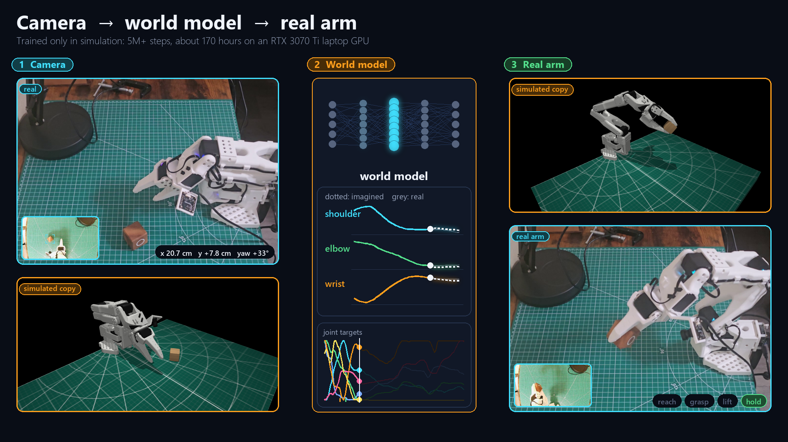

# DreamPick

**Sim-to-real cube picking on a 3D printed SO-101 arm, planned by a world model that never trained on the real robot.**

A webcam finds the cube, a simulated twin of the desk gets the same cube, a DreamerV3-style world model plans the whole pick inside the simulator, and the real arm replays the joint path it planned.



<p align="center"><a href="media/demo.mp4">Full demo video (41 s, 1080p)</a></p>

| | |
|---|---|
| Arm | [SO-101](https://github.com/TheRobotStudio/SO-ARM100), open source, 3D printed |
| Sensing | one overhead webcam, joint angles from the servos |
| Simulator | MuJoCo (Gymnasium environment included) |
| Training | about 170 hours of training, 5M+ simulated steps, one RTX 3070 Ti laptop GPU (8 GB) |
| Sim result | 84% pick success in a noisy simulator (wide cube zone, camera noise, occlusion) |
| Real arm | picks a real 3 cm cube from a plan made entirely in simulation |

## How it works



1. **Real to sim.** The overhead camera finds the cube on the mat and measures x, y and yaw. A camera-to-arm map (fitted once, using the arm itself as the ruler) puts the cube into the simulator's frame.
2. **World model plans.** The policy reads the six joint angles and the cube pose, imagines how the next moments will play out in a learned latent space, and chooses the moves that end with the cube in the gripper. It runs closed loop in the simulated twin at 20 Hz. The whole episode is planned before the real arm moves.
3. **Sim to real.** The recorded joint path is replayed on the real arm through a servo bridge: sim angles to servo ticks, limited to the real arm's usable ranges, with a short lead to cover servo lag.

The real arm never feeds back into the policy. It follows the path the sim arm took.

### What the model sees and does

| | |
|---|---|
| Input | 6 joint angles (with noise and a per-episode calibration offset) and the cube pose `x, y, cos(4 yaw), sin(4 yaw)` plus a visible flag. The cube is square, so yaw repeats every 90 degrees. No images. |
| Output | 6 desired joint speeds, clipped by a speed and an acceleration limit, integrated into joint targets |
| Environment | 20 Hz, 15 s episodes, real joint limits, randomised friction, cube mass and size, gripper force, servo gain and damping, action delay |
| Reward | reach, grasp bonus, lift height and hold, minus penalties for dragging the cube, sideways shift and pressing links into the table |
| Success | cube held at 5 cm or more for 3 s without sliding more than 3 cm sideways |

### Training in stages

Each stage has a pass/fail gate measured on fixed-seed episodes, not on the training score.

| Stage | What gets harder |
|---|---|
| S1 reach | narrow cube zone, exact observations |
| S2 grasp | pinch the cube without dragging it |
| S3 lift | lift and hold |
| S4 wide | wider zone, start anywhere between folded rest and home, camera noise, latency, occlusion by the gripper |
| S5 robust | randomised physics, joint and camera calibration errors |
| S6 polish | final acceptance |

Full plan and the reasoning behind every choice: [docs/training_run_3_plan.md](docs/training_run_3_plan.md).

## The journey: three runs, two failures



- **Run 1** took camera images and learned to reach and grab, but never to lift. The simulated gripper's collision shapes could not hold the cube, the camera lost sight of the cube at the moment of contact, and the reward had a loophole (drag the cube toward the base). Write-up and every plot: [docs/training_run_1](docs/training_run_1/README.md).
- **Run 2** fixed those and lifted the cube about 96% of the time in simulation. On the real arm it missed. Details: [docs/training_run_2](docs/training_run_2).
- **Run 3** dropped the images. The policy gets joint angles and a clean cube pose instead, which gives a much simpler bridge to the real arm. This is the run that picked a real cube.

Things that went wrong along the way, and what they taught:

- A model finds the cheapest way to score. A lift reward that counted height alone taught the arm to drag the cube across the table.
- Extra inputs can hurt. A "cube is hidden" flag added to help made training collapse until it was removed.
- Gates that were too strict cost days. Selection by eval score alone picked checkpoints that lifted less; fixed-seed success rates fixed that.
- Real hardware has its own physics: servo lag of about 0.2 s, joints that sag under gravity, an encoder that wraps inside the needed range, and a camera that cannot see the cube once the gripper covers it.

## Gallery

| Real arm, simulated copy and world model side by side | |
|---|---|
|  |  |

## Videos

All videos are in [media/](media).

| Video | What it shows |
|---|---|
| [demo.mp4](media/demo.mp4) | the final cut: camera, world model, simulated copy and the real arm, synced |
| [cut_cinematic.mp4](media/cut_cinematic.mp4) | a longer story cut |
| [cut_one_screen.mp4](media/cut_one_screen.mp4) | the whole pipeline on one screen |
| [real_to_sim_pick_a.mp4](media/real_to_sim_pick_a.mp4), [real_to_sim_pick_b.mp4](media/real_to_sim_pick_b.mp4) | the cube placed on the mat and appearing in the simulator |
| [sim_to_real_pick_a.mp4](media/sim_to_real_pick_a.mp4), [sim_to_real_pick_b.mp4](media/sim_to_real_pick_b.mp4) | the simulated arm and the real arm doing the same pick |
| [sim_policy_all_episodes.mp4](media/sim_policy_all_episodes.mp4), [sim_full_pick.mp4](media/sim_full_pick.mp4) | the final policy in simulation |
| [docs/training_run_1/videos](docs/training_run_1/videos) | what the first world model learned, stage by stage: imagined arm, reconstructions, training progression, policy rollouts |
| [docs/training_run_2/policy_tests](docs/training_run_2/policy_tests) | run 2 policy tests per stage |

## Repository layout

```
assets/                       SO-101 MJCF + meshes (vendored from SO-ARM100, Apache 2.0) and the pick-cube scene
src/so101_env/                Gymnasium environments (SO101PickCube-v0 with images, the state-based one used by run 3),
                              expert solver, camera-to-arm map, deploy wrapper, joint-target smoothing
src/dreamer/                  DreamerV3 (PyTorch), vendored from NM512/dreamerv3-torch (MIT), adapted to this env
scripts/
  run3_train.py               staged training with fixed gates, resumable
  run3_gate_eval.py           evaluate a checkpoint on fixed-seed episodes
  run3_status.py              where training is
  run3_policy_server.py       serves the trained policy over a local socket
  run3_follow_real.py         plan in sim, then the real arm follows the joint path
  run3_real_client.py         closed-loop real arm client (camera + joints in, targets out)
  sim_real_bridge.py          sim angles <-> real servos (ranges, offsets, lag lead, safety guards)
  phase1_*.py, locate_cube.py camera-to-arm calibration and the cube locator
  make_showcase*.py           builds the demo videos from a recorded run
docs/                         training plan, run 1 and run 2 write-ups, images
media/                        demo GIF and videos
tests/                        pytest suite for the environments
```

## Setup

Python 3.11, Windows (the scripts use PowerShell and COM ports; the simulation and training part is portable).

```powershell
python -m venv .venv
.venv\Scripts\Activate.ps1
pip install -r requirements.txt
# training also needs PyTorch (CUDA build) and a few extras
pip install torch==2.4.1 --index-url https://download.pytorch.org/whl/cu121
pip install -r requirements-dreamer.txt
```

Look at the scene, run the tests:

```powershell
python scripts\view_scene.py
pytest tests -v
```

## Train

Staged training, resumable (rerun the same command after any interruption):

```powershell
python -u scripts\run3_train.py --base outputs\run3
python scripts\run3_status.py          # progress, gate numbers
```

`scripts\start_run3.ps1` starts it as a hidden background process and `scripts\run3_watchdog.ps1` restarts it if it dies.

## Run on the real arm

The real-arm scripts need the [LeRobot](https://github.com/huggingface/lerobot) environment (motor drivers, OpenCV) and the follower arm connected. Two programs:

```powershell
# project venv: serves the trained policy
python scripts\run3_policy_server.py --checkpoint outputs\run3\s6_polish\stage_best.pt

# LeRobot venv: plan in sim, then the real arm follows
python scripts\run3_follow_real.py --real_cube
```

One-time calibration (camera to arm frame, joint offsets) is in `scripts\phase1_calibrate.py` and `scripts\phase1_fit_kinematics.py`. `scripts\run3_follow_real.py --dry` plans without touching any hardware. Keep a hand near the arm's power switch.

## Credits

- SO-101 arm design and MJCF model: [TheRobotStudio/SO-ARM100](https://github.com/TheRobotStudio/SO-ARM100) (Apache 2.0)
- DreamerV3: Hafner et al., *Mastering Diverse Domains through World Models*; PyTorch port: [NM512/dreamerv3-torch](https://github.com/NM512/dreamerv3-torch) (MIT)
- Real arm control: [LeRobot](https://github.com/huggingface/lerobot)
