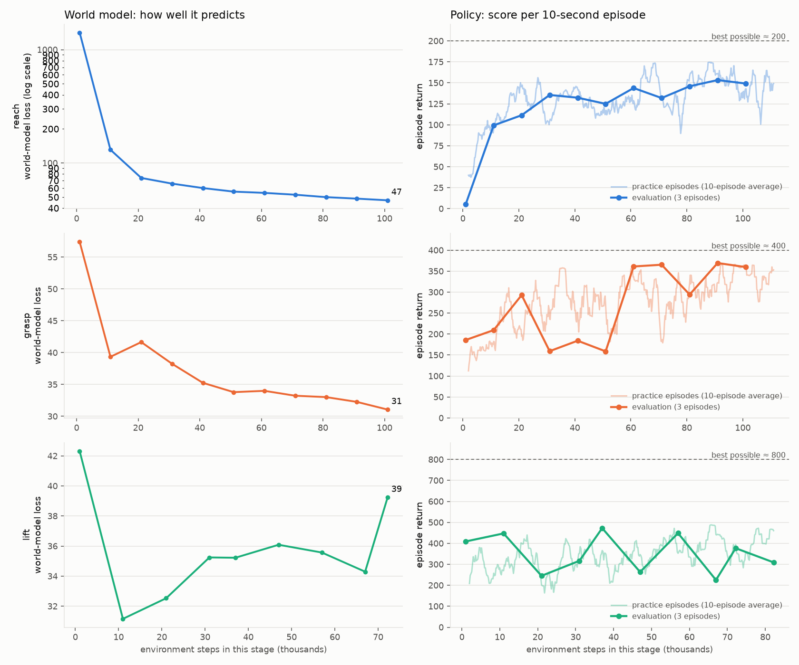
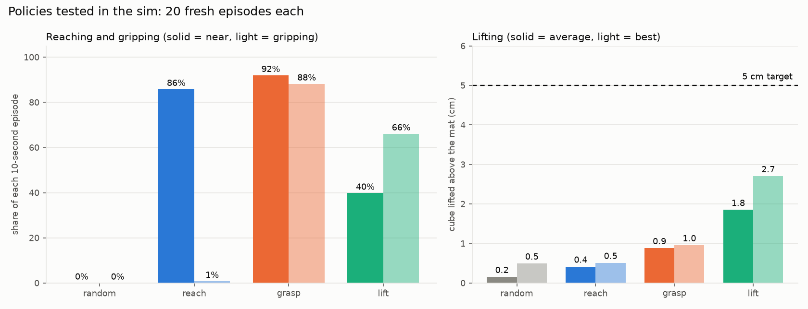
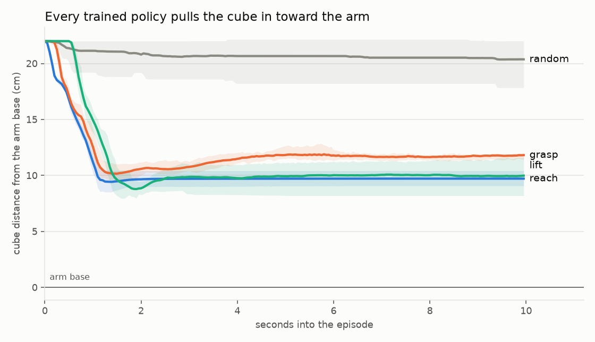
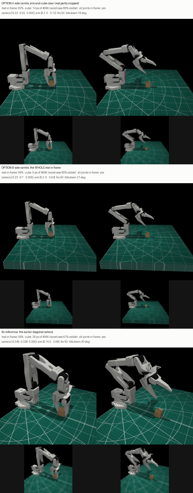
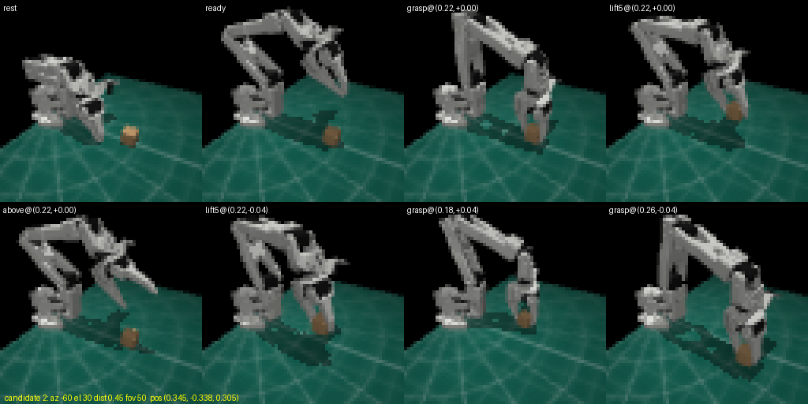

# Training run 1: teaching the SO-101 arm to pick up a cube (DreamerV3)

**Run dates:** 13 Oct 2026 16:58 to 14 Oct 2026 16:58. **Hardware:** RTX 3070 Ti Laptop GPU (8 GB).
**Outcome in one line:** the arm learned to reach the cube and to pinch it, but it never learned to *lift* it. All three trained policies drag the cube toward the arm's base instead, and the best lift reached 2.7 cm against a 5 cm target.

This folder documents what was built, how it trained, what the results really are, what went wrong, and what changes for the second run. Everything here was produced from the run's own saved data, so every number can be traced to `data/`.

| Folder | What is in it |
|---|---|
| `README.md` | this document |
| `plots/` | learning curves, policy test charts, the old camera's blind spot |
| `videos/policy_rollouts/` | the trained policies acting in the sim, with the three camera views |
| `videos/world_model/` | what the world model predicts and imagines, per stage |
| `videos/training_progression/` | how things changed over training, per stage |
| `camera_analysis/` | the measurement behind the new camera position |
| `data/` | raw metrics, the full console log, the config, the policy-test results as JSON |

---

## 1. Results at a glance

| Stage | Trained for | Best the arm achieved | Verdict |
|---|---|---|---|
| **Reach** | 111,000 steps, 6.2 h | gets within 2 cm of the cube in about a second, 86-90% of each episode | works |
| **Grasp** | 111,000 steps, 6.3 h | pinches the cube between both jaws 81-88% of each episode | works |
| **Lift** | 82,200 steps, about 4.6 h of training (11.5 h on the clock) | lifts the cube 1.8 cm on average, 2.7 cm at best; **0 of 20 episodes reached 5 cm** | does not work |

Tested in the sim over 20 fresh episodes per policy (section 7):

| Policy | Closest to cube | Time within 2 cm | Time pinching the cube | Avg peak lift | Best lift | Reached 5 cm |
|---|---|---|---|---|---|---|
| random actions | 4.4 cm | 0% | 0% | 0.2 cm | 0.5 cm | 0% |
| reach | 0.3 cm | 86% | 1% | 0.4 cm | 0.5 cm | 0% |
| grasp | 0.2 cm | 92% | 88% | 0.9 cm | 1.0 cm | 0% |
| lift | 0.7 cm | 40% | 66% | 1.8 cm | 2.7 cm | 0% |

The lift policy is *worse* than the grasp policy at reaching and pinching, and only slightly better at lifting. The main reasons, found after training, are in sections 8 and 9: the cube gets dragged instead of lifted, the overhead camera cannot see the cube once the arm reaches it, and the evaluation that decided when to stop was too noisy to be trusted.

---

## 2. What was built

### The simulation (MuJoCo)

- **The arm:** the official SO-101 model from TheRobotStudio's SO-ARM100 repository (`so101_new_calib` variant). Added by this project: a wrist camera mount and camera matching the physical camera module, and two thin **grasp pads** on the inside of the jaws (see section 8, problem 1).
- **The workspace:** a 61 x 46 cm green cutting mat matching the physical one, with its angle-guide printed so the **protractor's centre is exactly the arm's base**, as on the real desk. Grid lines every 1 cm, bolder every 5 cm.
- **The cube:** 3 cm, 20 g, rounded edges and wood texture, matching the physical wooden cube. It always started in the same place, 22 cm straight out from the arm's base.
- **Cameras:** the policy sees two 64 x 64 colour images, an **overhead** camera (fixed, behind the arm, looking forward and down at about 33 degrees from vertical) and a **wrist** camera (rides on the gripper, aimed between the jaws), plus the 6 joint angles.

### How the arm is controlled

- **Action:** 6 numbers between -1 and 1, one per joint (shoulder pan, shoulder lift, elbow, wrist flex, wrist roll, gripper). Each is a *nudge* to that joint's target: `new target = old target + action x 0.05 rad`, clipped to the joint's range.
- **One step** is one action followed by 0.05 s of simulated physics (25 physics ticks of 2 ms), so the arm acts 20 times per second.
- **One episode** is 200 steps, which is 10 s. The arm then resets to its home pose (plus 0.02 rad of random wobble per joint) and the cube returns to its start.

### The three reward stages

Every step pays a reward; an episode's score is the sum of its 200 steps. The stages add up:

```
reach = 1 - tanh(10 x d)            d = distance (m) from the cube's centre to the point halfway between the jaw pads
grasp stage reward = reach + (1 if the cube touches BOTH pads, else 0)
lift  stage reward = reach + (1 if grasped) + 2 x min(cube height / 5 cm, 1)
```

| Distance d | 0 cm | 1 cm | 2 cm | 5 cm | 10 cm |
|---|---|---|---|---|---|
| reach reward | 1.00 | 0.90 | 0.80 | 0.54 | 0.24 |

Best possible score per episode: about **200** (reach), **400** (grasp), **800** (lift). Each stage started from the previous stage's trained networks, so the arm did not relearn what the scene looks like, only the new goal.

---

## 3. How the learning method works (plain language)

The method is **DreamerV3**, using the open-source PyTorch port NM512/dreamerv3-torch (MIT licence, vendored in `src/dreamer/` with every change commented). It has three learned parts:

- **World model:** compresses each moment (two camera images and the joint angles) into a short *summary* (a latent state), learns to predict the *next* summary from the current one plus the chosen action, and learns to redraw the images and predict the reward from a summary. 26.2 million numbers.
- **Actor:** the policy. Looks at a summary and decides the 6 joint nudges. 1.06 million numbers.
- **Critic:** judges a situation by estimating how much reward is still to come. 1.18 million numbers.

The loop, repeated for the whole run:

1. **Collect:** the actor drives the arm in the sim and every step is stored (images, joints, action, reward).
2. **Learn the world:** sample 16 stretches of 64 consecutive stored moments and train the world model to predict them.
3. **Dream:** starting from real stored moments, the world model imagines 15 steps ahead, with no real simulation and no images drawn, just summaries.
4. **Learn from the dreams:** the actor is improved to choose moves the critic rates highly, and the critic to rate them accurately.

One note on "next-frame prediction": the *image* loss redraws the **current** frame from its summary (a check that nothing important was lost). Predicting the future happens between *summaries*; the world-model videos below show the decoded result.

The **train ratio** (256 in this run) sets how much learning happens per step collected: one training update every 4 environment steps. The upstream default is 512; it was halved because the laptop GPU overheated.

### Settings used

| Setting | Value |
|---|---|
| Steps per stage | cap 100,000 (practically up to ~110,000: a stage ends at the first check after the cap), early stopping |
| Random-action prefill | 1,000 steps at the start of each stage |
| Train ratio | 256 (one update per 4 steps) |
| Batch | 16 stretches x 64 moments |
| Dream length | 15 steps |
| Learning rates | world model 1e-4, actor 3e-5, critic 3e-5 |
| Evaluation | every 10,000 steps, **3 episodes** |
| Early stopping | stop when the best of the last 5 evaluations improves under 2% on the one before them |
| Checkpoints | `latest.pt` every 1,000 steps; a world-model-only milestone every 5,000 steps |
| GPU safety | training pauses at 85 C and resumes below 80 C |

---

## 4. Timeline

| When | What happened |
|---|---|
| 13 Oct 16:58 | Training launched: reach, then grasp, then lift, each as its own run feeding the next |
| 13 Oct ~20:00 | Found that early stopping could never trigger (a logging bug), fixed for later stages; the reach stage was already running |
| 13 Oct 23:12 | Reach finished (111,000 steps) |
| 13 Oct 23:14 | Grasp started from the reach weights |
| 14 Oct 05:30 | Grasp finished (111,000 steps) |
| 14 Oct 05:32 | Lift started from the grasp weights |
| 14 Oct 07:34 | Lift stopped at step 37,000 and resumed: its episodes were ending the moment the cube passed 5 cm, which teaches the arm to stop just short of it. Never actually triggered, so no data was affected |
| 14 Oct 09:32 | Training was **killed** at step 72,000 when the chat session that launched it ended. About 7 hours passed before it was noticed |
| 14 Oct 16:24 | Lift resumed from the step-72,000 checkpoint, this time launched independently of the session |
| 14 Oct 16:58 | Early stopping ended lift at step 82,200 |

Speed was about 4.9 steps per second throughout. The GPU hit the 85 C safety limit and paused **41 times, all during the reach stage**, and never during grasp or lift.

---

## 5. Stage results



### Reach (111,000 steps)

| Step | World model loss | Eval score (max about 200) |
|---|---|---|
| 1,000 | 1415 | 5 |
| 11,000 | 131 | 99 |
| 31,000 | 66 | 136 |
| 61,000 | 55 | 144 |
| 91,000 | 49 | 153 |
| 101,000 | 47 | 149 |

The world model's loss fell by 97%. The score climbed fast, then crept up with ordinary noise. By the end the arm reaches within 2 cm of the cube in about a second. It was **not** stopped early: the early-stop fix landed after this stage had started.

### Grasp (111,000 steps)

| Step | World model loss | Eval score (max about 400) |
|---|---|---|
| 1,000 | 57 | 186 |
| 21,000 | 42 | 293 |
| 31,000-51,000 | 38 to 34 | 159 to 184 |
| 61,000 | 34 | 361 |
| 91,000 | 32 | 370 |
| 101,000 | 31 | 360 |

The dip between 31,000 and 51,000 is a normal pause while it explores; the grasp "clicked" at about 61,000. Not stopped early because each check still showed large improvements.

### Lift (82,200 steps, stopped early)

| Step | World model loss | Eval score (max about 800) |
|---|---|---|
| 1,000 | 42 | 409 |
| 11,000 | 31 | 447 |
| 21,000 | 33 | 245 |
| 37,000 | 35 | 473 |
| 47,000 | 36 | 263 |
| 57,000 | 36 | 449 |
| 67,000 | 34 | 225 |
| 72,200 | 39 | 377 |
| 82,200 | | 309 |

The scores swing between 225 and 473 with no upward trend. Time spent pinching the cube moved between 46% and 79% across the run, and peak lift stayed around 1.4 to 1.8 cm.

**Why it stopped at 82,200:** the early-stop rule compared the best of the last 5 evaluations (449) to the one before them (473 at step 37,000) and found no improvement. With only 3 test episodes per evaluation and scores swinging this much, that comparison is mostly noise. The stage saved the *last* weights, not the best-scoring ones (see section 9).

---

## 6. Videos

### `videos/policy_rollouts/`: the trained policies acting

| File | What it shows |
|---|---|
| `random_policy_three_cameras.mp4`, `reach_`, `grasp_`, `lift_...` | Two 10-second episodes per policy. Left: a viewer camera for humans. Middle: the overhead image the policy sees (64 x 64, enlarged). Right: the wrist image the policy sees. The top bar shows time, return, whether the cube is pinched, and its height |
| `all_policies_side_by_side.mp4` | The first episode of random, reach, grasp and lift in a 2 x 2 grid |

### `videos/world_model/`: what the world model has learned (per stage)

| File | What it shows |
|---|---|
| `*_reconstruction_and_dream.mp4` | Top: real frames. Middle: the model's version (5 reconstructed frames, then imagined forward from actions alone). Bottom: the error |
| `*_world_model_progression_across_milestones.mp4` | The same episode reconstructed by each saved milestone in turn, so you watch the model sharpen over training |
| `*_imagined_arm_final_model.mp4`, `*_imagined_arm_progression.mp4` | The arm's imagined joint angles drawn on the 3D arm model, with the final model and across milestones |
| `*_train_openl_slideshow.gif`, `*_eval_openl_slideshow.gif` | The TensorBoard prediction videos, as a slow slideshow: real, predicted, error |

### `videos/training_progression/`: change over time (per stage)

| File | What it shows |
|---|---|
| `*_arm_motion_timelapse_every_update.mp4` | The arm's predicted pose after every 12th training update, with the wrist and overhead camera views in the corners: watch it go from flailing to purposeful |
| `*_what_the_model_saw_early_to_late.mp4` | Five stored practice episodes from the start to the end of the stage, exactly as the model saw them (overhead and wrist at 64 x 64) |

---

## 7. Testing the final policies in the sim

Run by `src/dreamer/evaluate_policy.py`: 20 fresh episodes per policy, a different seed from training, deterministic actions (and a second run with sampled actions: nearly identical). Raw results: `data/policy_test_deterministic.json`, `data/policy_test_sampled.json`.





**Finding 1, the arm drags the cube toward its base instead of lifting it.** For every trained policy the cube moves from 22 cm out to about 9 to 12 cm from the base within two seconds and stays there:

| Policy | Cube distance from base at 0 s | at 2 s | at 10 s |
|---|---|---|---|
| random | 22.0 cm | 20.8 | 20.4 |
| reach | 22.0 | 9.7 | 9.7 |
| grasp | 22.0 | 10.6 | 11.8 |
| lift | 22.0 | 8.9 | 10.0 |

The arm folds in with the cube pinched, holding it 1 to 2.5 cm off the mat. That keeps the reach and grip rewards high with no need to lift against gravity.

**Finding 2, the lift policy is weaker than the grasp policy at everything except lift height.** On the *lift* reward the grasp policy scores 408 and the lift policy 365 (in a first ad-hoc test of the same policies: 398 and 300). Treat the gap size as uncertain; the direction held in both tests.

**Finding 3, no policy ever reached 5 cm.** Best single episode: 2.7 cm.

---

## 8. Problems found and how they were handled

| # | Problem | When found | What was done |
|---|---|---|---|
| 1 | **The simulated gripper could not hold the cube.** MuJoCo collides a mesh as its convex hull, and the jaw meshes' hulls fill the gap between the jaws, so the cube was wedged against a slanted wall and squeezed out | before launch | Added thin box pads matching the real inner jaw faces, and excluded the jaw hulls from touching the cube (`assets/so101/so101_new_calib_camera.xml`, `assets/scene_pick_cube.xml`) |
| 2 | Grasp detection looked for jaw-mesh contacts, which now never happen | before launch | Detection and the reach distance now use the pads (test added) |
| 3 | The train ratio of 256 was only a command-line setting; the curriculum launcher did not pass it | before launch | Made it part of the config |
| 4 | **Early stopping could never trigger.** The check read the evaluation score from the logger's memory, but the logger had already written and cleared it | during reach | The check now reads the history from `metrics.jsonl`, which also survives restarts (two tests added). Reach had already started, so it ran to its cap |
| 5 | **Lift episodes ended the instant the cube passed 5 cm.** Since every step pays reward, ending early cuts reward off, which teaches the arm to hover just below 5 cm | during lift, at step 37,000 | Episodes no longer end on success during training. Stopped, backed up, resumed. No episode had ever reached 5 cm, so no saved experience was affected |
| 6 | **Training was killed when the launching chat session ended** (step 72,000, 7 hours lost) | next morning | Resumed from the checkpoint, launched independently of the session |
| 7 | The GPU overheated at the original train ratio (previous attempt) | before this run | Halved the ratio to 256; 41 cooling pauses happened during reach, none afterwards |

---

## 9. What this run taught us

1. **The overhead camera cannot see the cube when it matters.** It sits behind the arm on its centre line, and the cube is straight ahead on that line. Once the arm reaches the cube, the arm hides it. Measured at 64 x 64 in the gripping pose: **0 pixels of the cube visible.** The wrist camera does see it (clearly, between the jaws), but no camera sees how high the cube is while it is held, so the model has to guess height from joint angles. See `plots/old_cameras_in_gripping_pose.png` and `camera_analysis/old_overhead_camera_64px_views.png`.
2. **The lift reward does not make lifting worth the effort.** It pays only 0.4 per centimetre lifted, while dragging the cube in and holding it keeps most of the reward with no real work.
3. **The evaluation was too small to steer by.** Each check used only 3 test episodes, and the lift scores jumped between 225 and 473 from one check to the next with no upward trend, so progress could not be told from luck. Stopping decisions made on that are close to coin flips.
4. **The saved lift policy is the last, not the best.** The stage kept only the latest weights. Milestones keep the world model only, not the actor, so the best-scoring policy no longer exists.
5. **The cube always started in the same place.** A policy trained that way learns one spot, and cannot be expected to work elsewhere on the mat.
6. **The real arm cannot reach the sim's full wrist range.** The wrist motor's calibrated range crosses the encoder's rollover point, so the real arm can only use the wrist up to about +66 degrees (the sim allows 95). A policy trained in the sim is free to use wrist angles the real arm cannot follow. Section 11 shows how much this limits lifting.
7. **Anything started from a chat session dies with it.** Long runs must be launched independently.

---

## 10. The camera: how the new position was chosen

The first camera was picked by eye, from one resting pose, and it failed exactly where it mattered. This time `scripts/camera_search.py` renders the real 64 x 64 observation for **360 candidate camera positions** across **19 arm-and-cube situations** (home and ready poses, plus approaching, gripping and carrying the cube at seven positions across the start zone). For each it counts the pixels of the cube and of every arm link, and checks that every joint projects inside the image.

- **Old camera:** worst-case cube visibility **0%**, and joints cropped out of the frame.
- **First search result:** only 11 of 360 candidates kept every joint in frame, every link visible and the cube visible in every situation. Best was a low diagonal view (`camera_analysis/new_camera_choice_64px_views.png`, ranking in `camera_analysis/all_360_candidates_ranked.csv`).
- **Then the project owner asked for a pure side view**, level with the middle of the mat, at the same height (30.5 cm), seeing the arm in profile and as much of the mat as possible. `scripts/camera_search_side.py` and `scripts/camera_compare_side.py` searched that family. The trade-off is real: the cube is 3 cm on a 61 cm mat, and at 64 x 64 pixels every centimetre of extra mat in view costs cube pixels.

| Option | Mat in frame | Cube size (of 4096 px) | Notes |
|---|---|---|---|
| **A: side-centre, arm and cube clear (chosen)** | 82% | 12 to 15 px in every situation (average 14), at least 80% visible | camera 55 cm to the side |
| B: side-centre, the whole mat | 99% to 100% | 7 to 9 px | camera 70 to 78 cm to the side; rejected, the cube becomes a dot |
| the earlier diagonal view | 56% | 28 px | kept as the reference |



*The three options in the order above (the first two use the corrected measurement). Each shows a gripping pose and an approach pose, full size and at the 64 x 64 the policy gets.*

- **Chosen: Option A.** Camera at **x = 0.23 m, y = -0.55 m, z = 0.305 m** (world frame, arm base at the origin, x pointing out from the arm), aimed at **(0.20, 0, 0.12)**, **50 degree** vertical field of view, tilting down about 19 degrees. That is level with the middle of the mat (23 cm out), 55 cm to the arm's right and 30.5 cm up, looking across at the arm in profile. Across 19 approach, grasp and carry situations the cube is never less than 80% visible, never smaller than 12 pixels, and all six joints stay in frame (closest to the border: 3 px).
- **A bug in the measurement, found and fixed on the way.** When the search moved the camera's aim point, the camera orientation refreshed one evaluation late, so the first situation of each candidate (the folded rest pose) was measured with the previous candidate's aim. Fixed (`scripts/camera_search.py`) and every number above re-measured; the earlier ranking's cube measurements were not affected.



*The earlier diagonal candidate at 64 x 64 (for the record; the old camera is `camera_analysis/old_overhead_camera_64px_views.png`).*

To use this on the real arm, mount the physical camera in that spot, pointing at the same target.

---

## 11. How far the real arm can lift, by cube position

Measured with the same solver and the real arm's usable joint ranges (wrist at most about 66 degrees). Table: the highest the gripper's grasp point can be held with the arm pointing mostly downward (tilt up to 60 degrees), in cm. A 5 cm lift needs the grasp point at about 6.5 cm.

| cube out from the base (cm) | 8 cm to the left | 4 left | centred | 4 right | 8 right |
|---|---|---|---|---|---|
| 16 | 4.0 | 1.5 | 1.5 | 1.5 | 4.0 |
| 18 | 7.8 | 4.0 | **2.8** | 4.0 | 7.8 |
| 20 | 15.3 | 9.0 | 6.5 | 9.0 | 15.3 |
| 22 | 15.3 | 15.3 | 15.3 | 15.3 | 15.3 |
| 24 to 28 | 15.3 | 15.3 | 15.3 | 15.3 | 15.3 |

Finer steps near the edge (same measure):

| cube out from the base (cm) | 6 left | 4 left | 2 left | centred | 2 right | 4 right | 6 right |
|---|---|---|---|---|---|---|---|
| 20 | 14.0 | 9.0 | 6.5 | 6.5 | 6.5 | 9.0 | 14.0 |
| 20.5 | 15.3 | 12.8 | 9.0 | 9.0 | 9.0 | 12.8 | 15.3 |
| 21 | 15.3 | 15.3 | 14.0 | 12.8 | 14.0 | 15.3 | 15.3 |
| 21.5 and beyond | 15.3 | 15.3 | 15.3 | 15.3 | 15.3 | 15.3 | 15.3 |

So the original cube spot (22 cm out) is comfortable, but a start zone of "plus or minus 4 cm around it" would reach back to 18 cm, where a 5 cm lift is physically impossible for the real arm (2.8 cm at best when centred). Lifting is only just possible at 20 cm (6.5 cm, needed about 6.5) and comfortable from 21 cm. Run 2 therefore uses the same size of zone but shifted outward: **21 to 29 cm out, 4 cm either side.**

---

## 12. The plan for run 2

Decisions confirmed with the project owner, plus what the measurements above require:

| Topic | Run 1 | Run 2 |
|---|---|---|
| Fixed camera | behind the arm, 33 degrees from vertical | side view level with the mat's centre (section 10) |
| Cube start | always 22 cm out, no rotation | small random zone, random rotation; kept at 21 cm and beyond (section 11) |
| Lift reward | 0.4 per cm; success ends the episode | much steeper per cm, a bonus for holding 5 cm, a penalty for dragging the cube toward the base |
| Joint limits in the sim | sim's full range | the real arm's usable range, so the policy cannot use motions the real arm cannot follow |
| Evaluation | 3 episodes | 10 episodes per evaluation, every 10,000 steps |
| Checkpoint kept | last | best-scoring (policy and world model) |
| Early stopping | cannot trigger in the first stage; noisy | works in every stage; never before step 40,000; stops when the best of the last 5 evaluations improves under 2% |
| Step cap | about 100,000 per stage (ended at 111,000) | 140,000 (a stage ends at its first check past that: about 151,000) |
| Launching | from the chat session | independent of the session |

The exact settings as launched are in section 16.

---

## 13. Related work: linking the sim to the physical arm

Separate from training, a bridge was built so the simulator controls the physical arm (`scripts/sim_real_bridge.py`, `scripts/sim_real_demo.py`): mirror mode (move the real arm by hand and the sim copies it), drive mode (move the sim and the real arm follows), and a scripted pick-up routine. Things learned there that matter to training:

- The real wrist motor's encoder rolls over inside its calibrated range, so LeRobot's own reading is wrong past about +71 degrees, and commanding past it would turn the motor the long way round. The bridge reads raw encoder values and never commands past it.
- Under load the real arm's shoulder, elbow and wrist settle a few degrees lower than commanded. The bridge learns that sag per joint, scaled by the gravity load.
- Recalibrating the wrist motor so its range does not straddle the rollover point would restore its full range (not done).

---

## 14. Reproducing and regenerating this

All commands from the project root, with the project's `.venv`.

```
# the whole documentation set from a finished logdir
.venv\Scripts\python.exe scripts\make_training_docs.py --base_logdir outputs\dreamer_logdir --out docs\training_run_1

# just the policy test, with videos
cd src\dreamer
..\..\.venv\Scripts\python.exe evaluate_policy.py --base_logdir ..\..\outputs\dreamer_logdir --episodes 20 --video_dir ..\..\outputs\policy_test

# the camera search
.venv\Scripts\python.exe scripts\camera_search.py --top 10
```

## 15. Honest limits of this document

- The evaluation scores in section 5 use only 3 episodes and swing a lot; the 20-episode policy tests in section 7 are more reliable but still vary between runs (the same policies scored 300 and 365 on the lift reward in two tests).
- Heights in the stage-progress remarks were estimated from stored rewards and are accurate to a few millimetres; the policy test measures them directly.
- The reach stage's early-stopping history exists but could not have stopped it (problem 4).
- The final checkpoints and per-stage replay data from this run are deleted when run 2 starts. What remains is this folder.

---

## 16. Run 2 as launched

Verified before launch by `scripts/preflight_check.py` (25 checks, all passing; see `docs/training_run_2/setup_preview.png` for the preview) and 61 automated tests.

| Setting | Value |
|---|---|
| Fixed camera | side-centre view: position (0.23, -0.55, 0.305) m, aimed at (0.20, 0, 0.12), 50 degree field of view; about 82% of the mat in frame, cube at least 12 pixels |
| Cube start | 21 to 29 cm out, 4 cm either side, random rotation; every corner liftable (grasp point reaches 12.8 cm or more) |
| Joint limits | the real arm's usable range: wrist at most 65.9 degrees, shoulder lift at most 79.1 degrees, elbow within 93.7 degrees |
| Reward, all stages | reach (as before) minus a drag penalty: free for the first 2 cm the cube is pulled toward the base, ramping to 3.0 per step at 8 cm |
| Reward, grasp | + 1.0 per step while the cube touches both jaw pads |
| Reward, lift (first attempt; replaced in the retry, section 17) | + 6.0 x (height / 5 cm, capped) + 2.0 while at 5 cm or higher. Best possible: 10 per step, about 2000 per episode |
| Episodes | 200 steps; never end early on success |
| Per stage | up to 140,000 steps (ends at about 151,000 at most); 1,000 random-action steps to start; train ratio 256 |
| Evaluation | 10 episodes every 10,000 steps; best-scoring weights kept as `best.pt` and handed to the next stage |
| Early stopping | not before 40,000 steps; stop when the best of the last 5 evaluations improves under 2% |
| Launch | `scripts/start_training.ps1`, independent of any terminal or chat session; progress with `scripts/training_status.py`; safe to rerun to resume |
| After each stage | `scripts/stage_policy_test.py --watch` (started by the same launcher) tests the stage's best weights for 20 fresh episodes on the CPU and writes `docs/training_run_2/policy_tests/<stage>_policy_test.md` (with run 1's numbers alongside, flags for dragging, pinching and reaching 5 cm) and videos |

At about 4.9 steps per second, a stage that runs to its cap takes about 8.5 hours, so the worst case for the three stages is about 26 hours. Early stopping is expected to shorten that.

Things deliberately **not** changed, so run 2's results compare cleanly with run 1: image size (64 x 64), the world-model and policy networks, learning rates, the train ratio, the stage order, and the 3 cm cube.

---

## 17. Run 2: results, and the lift retry

Run 2 trained reach, grasp and lift in one go (13 to 19 hours, 18 to 19 Oct 2026; reach ended at step 141,000, grasp at 131,000 and lift at 81,000, all by early stopping). Each stage's best weights were tested for 20 fresh episodes straight away (`docs/training_run_2/policy_tests/`).

| Stage | Best eval | Policy test |
|---|---|---|
| Reach | 183 of about 200 | 74% of the episode within 2 cm of the cube; cube pulled toward the base: -1.0 cm (run 1: +11.6 cm) |
| Grasp | 365 of about 400 | pinches the cube 81% of the episode; cube pulled toward the base: -3.8 cm (run 1: +9.5 cm) |
| Lift, first attempt | 723 of about 2000 | pinches 62%; **best lift 2.9 cm, average 2.0 cm, 0 of 20 episodes reached 5 cm** |

**What worked:** the dragging fix. In run 1 every policy pulled the cube in 9 to 12 cm in 100% of episodes; in run 2 none does (0% beyond 5 cm).

**What did not: lift, the same ceiling as run 1.** The final lift weights (step 81,000) peaked at 2.3 cm on average, and 17 of 20 episodes sat between 2.3 and 2.7 cm. Highest-point renders (`policy_tests/lift_attempt1_highest_points.png`) show the arm holding the cube by the jaw tips about 2.4 cm up and **carrying it about 20 cm sideways** (from (21, 3) cm to (21, -17) cm). The drag penalty only counted movement toward the base, so sideways carrying was free, and it collected the reach, pinch and a little lift reward without ever raising the arm.

**Ruled out:** the real-arm joint limits. With them switched off, the same policy still peaked at 2.4 cm (best 2.6) and moved the cube 23.9 cm; with them on, 2.4 cm and 23.0 cm. The shoulder-lift command was pinned at its maximum at the highest point of every episode checked, but removing the cap changed nothing.

### The retry (lift stage only; reach and grasp are not retrained)

| | First attempt | Retry |
|---|---|---|
| Lift pays | 1.2 per cm, +2.0 at 5 cm | **2.0 per cm, +4.0 at 5 cm** |
| Sideways carrying | free | **penalty up to 5.0 per step**: free for 3 cm of movement from the start, full at 8 cm, in any direction |
| Toward-the-base drag penalty | up to 3.0 | unchanged (the larger of the two penalties applies, they do not add) |
| Best possible per step | 10 | 16 (about 3200 per episode) |
| Starts from | grasp best weights | grasp best weights |

Per step, lift stage, cube pinched:

| Situation | First-attempt reward | Retry reward |
|---|---|---|
| pinching it on the mat | 2.0 | 2.0 |
| the first attempt's shortcut: 2.4 cm up, carried 20 cm sideways | 4.9 | **1.8** |
| 2.4 cm straight up | 4.9 | 6.8 |
| 3.5 cm straight up | 6.2 | 9.0 |
| held at 5 cm straight up | 10.0 | 16.0 |

The shortcut now scores below simply holding the cube still, and every extra centimetre of straight lift pays. This is a design change that has not been proven yet: it makes the shortcut a loss, but does not by itself show the arm can find a straight lift. If lift stalls again, the next step is to start episodes with the cube already pinched (so lifting is practised from the first step).

The first attempt's data is archived as `outputs/dreamer_logdir/lift_attempt1`. The policy-test report now also measures how far the cube ends from where it started in any direction, which would have caught this shortcut (the first run-2 report only measured movement toward the base). The retry started on 19 Oct 2026 at about 08:45.

### 17b. The retry's first 151,000 steps, then the extension (outcome: lift solved in the sim)

The retry reached the 140,000-step cap at step 151,000 and was still improving slowly, so it was extended instead of redesigned. Results (20 fresh episodes each, `docs/training_run_2/policy_tests/`):

| Checkpoint | Best eval | Avg best lift | Best lift | Reached 5 cm | Cube moved >8 cm |
|---|---|---|---|---|---|
| First attempt (step 81k) | 723 | 2.0 cm | 2.9 cm | 0% | 95% |
| Retry, step 141k (`lift_attempt2_*`) | 1030 | 3.2 cm | 8.5 cm | 5% | 5% |
| Retry, step 151k (`lift_attempt2_step151k_*`) | 1048 | 2.7 cm | 2.9 cm | 0% | 0% |
| **Extended, step 241k (`lift_policy_test.md`)** | **2678** | **6.9 cm** | **10.2 cm** | **100%** | 5% |

The extended stage held the cube at 5 cm or higher for 83% of the episode and pinched it 86% of the time, with the cube ending 4.2 cm from its start on average (the first attempt carried it 22 cm). Eval scores sat near 1000 until about step 151k, then climbed to the 2000s after step 190k and peaked at 2678 at step 241k; the stage ended at step 291k.

Two lessons. (1) Stopping at the first cap would have left lift unsolved: the big gains came after step 190k. (2) The eval score is not a reliable stand-in for lifting: the step 151k weights scored higher than step 141k (1048 vs 1030) but lifted less (2.7 cm vs 3.2 cm, 0% vs 5% reaching 5 cm). Always run the policy test.

Mechanics of the extension: the finished stage's marker was removed and the stage resumed from its latest checkpoint with a 300,000 cap. The first extension attempt ended at once because the plateau rule fired on resume (1.9% gain against a 2% threshold), so a `--early_stop_min_steps` override was added (`train_curriculum.py`, `start_training.ps1 -MinStopSteps`); the second run used a 250,000 minimum. Snapshot of the step 141k weights: `outputs/lift_attempt2_snapshot/`.

### 17c. Checkpoint selection on 200 episodes

The 20-episode test was optimistic. Each full checkpoint was re-tested on the same 200 fresh cube positions (`docs/training_run_2/checkpoint_selection/`, script `scripts/select_checkpoint.py`). The 5,000-step milestone files hold only the world model, not the actor, so only four full checkpoints exist:

| Step | Held at 5 cm+ | Ends holding | Reached 5 cm | Avg best lift | Cube ends >8 cm away |
|---|---|---|---|---|---|
| 141k | 0% | 0% | 6% | 3.1 cm | 6% |
| 151k | 1% | 0% | 9% | 3.5 cm | 10% |
| 241k (`best.pt`) | 80% | 90% | 95% | 6.6 cm | 6% |
| **291k (`latest.pt`)** | **82%** | **91%** | **96%** | **7.0 cm** | 6% |

So the realistic lift rate is about 95% (not 100%), and about 6% of episodes end with the cube more than 8 cm from where it started. Steps 241k and 291k are effectively tied (the gap is inside the noise of a 200-episode test). Both are kept as `outputs/final_policy/lift_step241000.pt` and `lift_step291000.pt`; 291k ranks first.

### 17d. Smoothness and slip penalties: tried, did not help

The lift stage was retrained from the step-291k weights (`outputs/dreamer_logdir_v3/`) with two extra reward terms, lift stage only: a smoothness cost (2.0 x the average change in action between steps) and a slip cost (up to 5.0 per step for opening the gripper while the cube is more than 1 cm off the table). Early stopping ended it at step 51,000 (cap 100,000, earliest stop 50,000). Eval scores never beat the very first one at step 1,000, which is essentially the old policy: 2329, 656, 1888, 1380, 1933, 1095.

Test on 50 fresh episodes, same seeds, new reward in both rows:

| Weights | Avg action change per step | Avg best lift | Reached 5 cm | Held at 5 cm+ | Return |
|---|---|---|---|---|---|
| Step 291k (before) | 0.30 | 7.0 cm | 94% | 81% | 2269 |
| Retrained, step 51k | 0.28 | 5.7 cm | 76% | 48% | 1214 |

The motion got no smoother (0.28 vs 0.30), slipping did not drop (penalty 42 vs 27 per episode), and the lift got clearly worse. Conclusion: with these weights the penalties cost lift reliability and bought nothing. Step 291k stays the final policy (`outputs/final_policy/lift_step291000.pt`). Possible next tries, not done: much smaller penalty weights, or randomising physics instead of penalising motion.

### 17e. Smoothing the policy's commands for the real arm (open-loop): not possible without losing the lift

Goal: gentle motion for the real arm's servos and gears (low acceleration, no direction-flip tremor). Measured on the step-291k policy (20 episodes): only 6% of actions at the limit, peak joint acceleration about 40 to 55 rad/s^2, peak joint speed 1.4 to 2.0 rad/s, reach+grasp+lift done in about 0.9 s (the cube goes from 1 cm to 5 cm in 0.10 s), and 48% of steps while holding flip an arm joint's action sign (a tremor).

Experiment (`scripts/smooth_replay_test.py`, `src/so101_env/smoothing.py`): record the policy's joint-target trajectories on 50 cube positions, smooth them (low-pass filter on the commanded speed, a limit on how fast that speed may change, optional slow-down), and replay them open-loop in the sim from the same start state. Unsmoothed replay reproduces the policy (92% to 94% reach 5 cm), so the method is valid. Full tables: `docs/training_run_2/smoothing_option1.md` and `smoothing_option1_mild.md`.

| Setting | Reached 5 cm | Ends holding | Peak accel (rad/s^2) | Direction flips while holding |
|---|---|---|---|---|
| none | 94% | 92% | 57 | 48% |
| accel limit 40 only | 94% | 90% | 57 | 43% |
| accel limit 25 only | 50% | 14% | 45 | 44% |
| filter 0.05 s | 18% | 10% | 31 | 30% |
| filter 0.1 s | 4% | 4% | 23 | 27% |
| filter 0.25 s | 2% | 0% | 15 | n/a |
| 1.5x slower, no filter | 70% | 40% | 37 | 31% |
| 2x slower, no filter | 62% | 22% | 27 | 23% |
| filter 0.25 s + accel 8, 2x slower | 8% | 6% | 11 | 12% |

Every setting that meaningfully reduces acceleration or tremor loses the lift. The policy depends on its sharp, precisely timed motion and corrects itself from camera feedback during the grasp, which an open-loop replay cannot do. Smoothing inside training (the alternative) was considered and dropped by decision. The smoothness and slip reward penalties of 17d are left in the code but switched off (`_SMOOTH_PENALTY`, `_SLIP_PENALTY` = 0).

Caveats: the numbers are the sim arm's motion. The sim servo is stiff (kp 998), and the real arm runs soft servo gains (LeRobot's), so real accelerations are probably lower than these. The real arm has not been measured. The bridge already caps each goal change at 4 degrees per step (`--max_step`).
